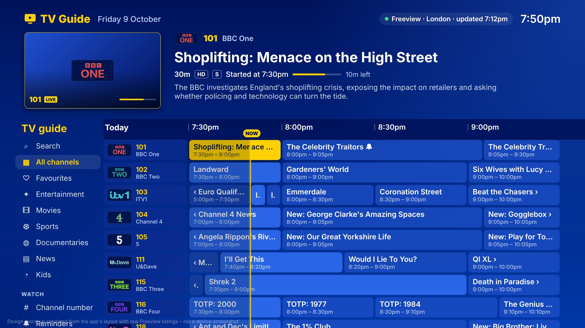
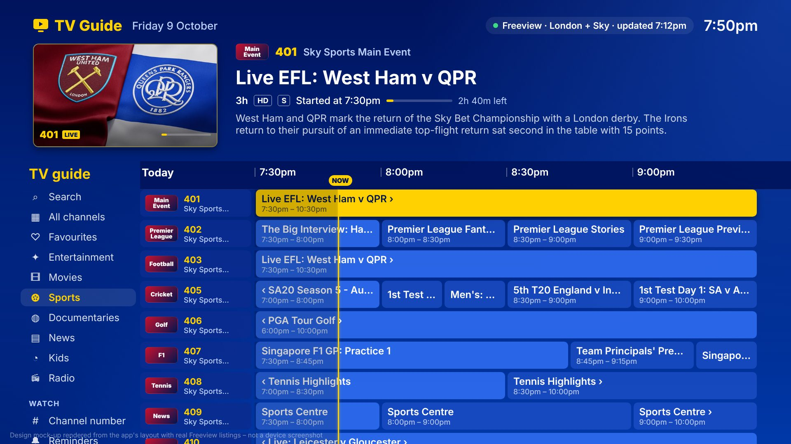
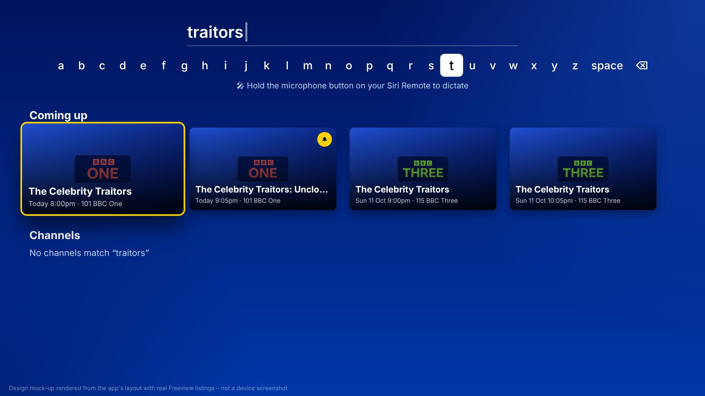
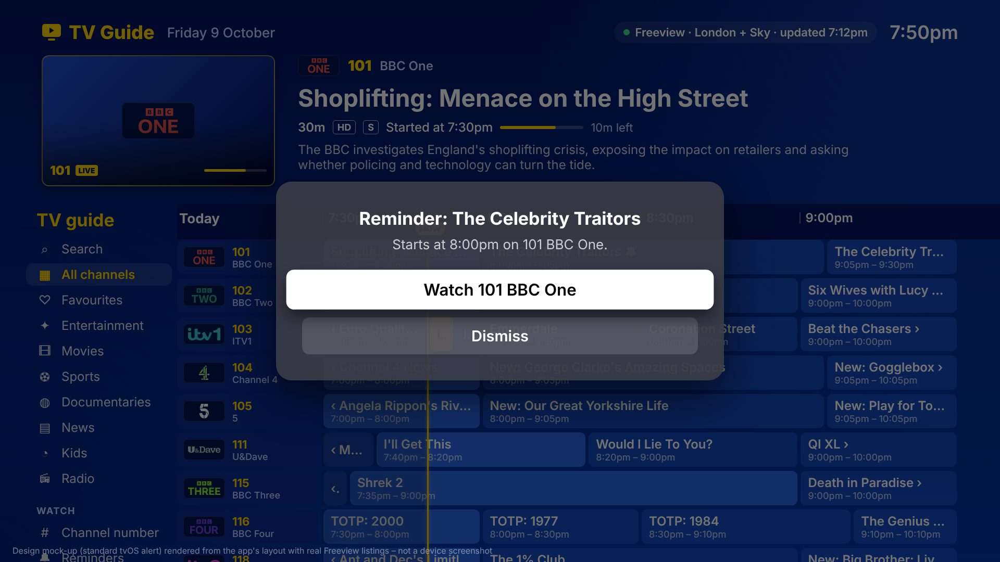
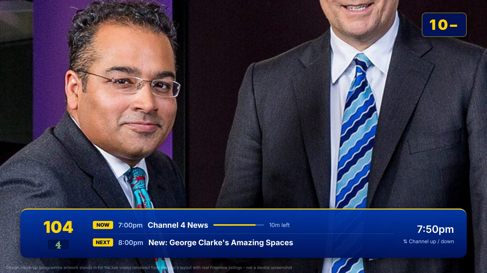
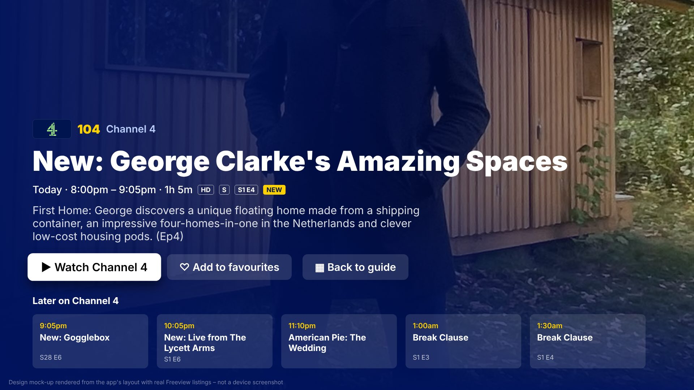
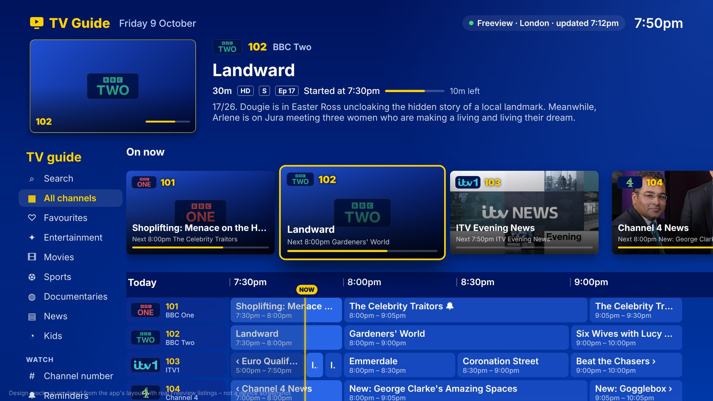

# TV Guide for Apple TV

A classic Sky style TV guide for **Apple TV (tvOS 17+)**, in Sky blue and yellow, built in SwiftUI for the UK free-to-air line-up. Channels use Sky style numbers (**101 BBC One, 102 BBC Two, 103 ITV1, 104 Channel 4, 105 5**…), and you can launch straight into live TV.



| Sky Sports (Sky channels on) | Search with dictation | Reminder |
| --- | --- | --- |
|  |  |  |
| **Live TV banner** | **Programme info** | **On now tiles** |
|  |  |  |

*These are design mock-ups rendered from the app's layout with real listings, not device screenshots. Run the app in the Apple TV simulator for the real thing.*

## Watching live TV

- **Select** a programme that's on now (in the grid or the On now tiles) to watch the channel full screen. Select a future programme to see its info.
- **Type a channel number** Sky style – 1, 0, 1 for BBC One – from a keyboard or universal remote with number keys, or use **Channel number** in the sidebar for an on-screen keypad with the Siri Remote. It tunes after three digits or a 2 second pause.
- While watching, press **up / down** for channel up / down. A Sky style now & next banner (yellow channel number, logo, progress, what's next) appears on every change; press **select** or left/right to bring it back. **Play/Pause** pauses, **Menu** returns to the guide.

### Where the pictures come from

Apple TV has no aerial input, so live pictures need a tuner on your home network. Set it up under **Live TV** in the sidebar:

1. **HDHomeRun + Channels DVR (recommended).** An HDHomeRun Freeview tuner plugged into your aerial and router, plus [Channels DVR](https://getchannels.com) running on a Mac, PC or NAS. The app **finds Channels DVR servers automatically** (Bonjour), or you can type the address (e.g. `192.168.1.20`, port 8089 by default). It then:
   - plays every channel the tuner receives, using Channels DVR's HLS streams (`/devices/ANY/channels.m3u?format=hls`);
   - reads the **guide from your aerial** via Channels DVR (`/devices/ANY/guide`), which fills in any channel the internet listings miss and takes over completely if the internet listings can't be downloaded.

   The app also spots HDHomeRun tuners on your network. On their own they stream MPEG-TS, which Apple TV can't play, so the app tells you to add them to Channels DVR.
2. **Any M3U playlist of HLS streams** – Jellyfin, Plex, TVHeadend or an IPTV service. Channels are matched to the guide by `tvg-id` or by name (tuner names like "BBC ONE Lon HD" or "ITV1 +1" are understood). If the playlist header links an XMLTV guide (`url-tvg`), it's used as backup listings too.
3. **The broadcaster's app (fallback).** If a channel has no stream, the player offers **Watch in BBC iPlayer / ITVX / Channel 4 / 5 / U / NOW**. These deep links aren't officially documented, so they're best effort.

Sky channels arrive by satellite, so a Freeview tuner can't receive them; watch those in the NOW app or via an IPTV playlist that carries them.

`TVGuide-Info.plist` allows plain `http`, local-network access and Bonjour browsing for `_channels_dvr._tcp`.

## Radio

Like Sky, radio stations sit after the TV channels with **0-prefixed numbers** – type **0101** for BBC Radio 1, or choose **Radio** in the sidebar. About **156 stations**, Sky style numbering:

| Numbers | Stations |
| --- | --- |
| 0101–0142 | Sky's own radio list: BBC Radio 1–6 Music, 1Xtra, 4 Extra, 5 Sports Extra, World Service, Asian Network, the BBC nations stations, Classic FM, talkSPORT, Capital, Capital Xtra, Heart (+80s, 90s, Dance), Radio X, Gold, LBC, LBC News, Smooth, Virgin Radio, Times Radio, RTÉ … |
| 0143–0146 | Extra BBC streams: Radio 1 Dance, Radio 1 Anthems, Radio 3 Unwind, BBC Live News |
| 0150–0189 | National: **Absolute Radio** (+70s, 80s, 90s, 00s, 10s, Classic Rock, Country), KISS, KISSTORY, KISS XTRA, Magic (+Mellow, Soul, Musicals, Classical), Greatest Hits Radio (+60s, 70s, 80s), Hits Radio (+90s, 00s, Chilled), Jazz FM, Planet Rock, Kerrang!, heat, Boom Radio, GB News Radio, **LBC London**, Capital Dance/Chill, Heart 70s/00s, Smooth Chill/Country, Radio X Classic Rock |
| 0200–0241 | **BBC Local Radio** – every English local station plus Guernsey, Jersey, Orkney and Shetland |
| 0260 onwards | Regional: Clyde 1, West FM, Forth 1, Northsound 1, MFR, Tay FM, Smooth Scotland, **Cool FM**, **Downtown Radio**, Downtown Country, Capital Cymru, Capital South Wales, Heart Wales, Radio City, Rock FM, Metro, Hallam, Viking, Free Radio, Gem 106, Capital Manchester/Midlands, Heart and Smooth regions |

- **Plays directly in the app** from the broadcasters' own streams: the BBC's HLS streams, Global's (Capital, Heart, Smooth, LBC, Radio X, Classic FM, Gold), Rayo's (Absolute, KISS, Magic, Greatest Hits, Hits Radio, Cool FM, Downtown, Clyde …), talkSPORT, Virgin, Times Radio, Boom and GB News. BBC and Global addresses were checked when added (`TVGuide/Models/RadioStations.swift`, `RadioCatalogue.swift`); Rayo's are loaded live from Rayo's station list, so they stay current. If a stream fails the player tries the station's next one.
- **Listings and live info:** Sky's radio listings for 0101–0142, the Freeview guide for BBC local radio, and for Rayo stations the show on air plus the **song playing now** (refreshed every 30 seconds on the radio screen). Stations without published listings show their strapline.
- A Sky style **now playing** screen: big logo and number, current show with progress, the song playing, a moving level meter and what's next. **Up / down** changes station.
- Radio **keeps playing when you leave the app** and shows in the Apple TV's Now Playing screen.
- Notes: Rayo's streams only play in the UK. KISS DANCE and Cool Old Skool stream only to Rayo Premium subscribers, and WRN Europe and BFBS have no public stream, so these show listings only. The BBC streams used are the international ones, so a few programmes (some sports commentary) can be replaced.

## Search, reminders and Sky channels

- **Search** (top of the sidebar) uses tvOS's own search screen: the A–Z keyboard row, or **hold the microphone button on the Siri Remote and say** a programme, channel name or number. Results show channels, what's on now (select to watch) and what's coming up across the week (select for info, press and hold to set a reminder).
- **Live preview window** – the panel at the top has a little TV that follows focus as you move up and down the guide or along the tiles. With a live TV playlist set up it plays the channel muted (after a short pause so fast scrolling doesn't start lots of streams); otherwise it shows the programme's artwork.
- **Reminders** – press and hold a future programme (or use **Remind me** on its info page). A bell shows in the grid. A minute before it starts you get an alert with **Watch** / **Dismiss**, in the guide or while watching another channel. **Reminders** in the sidebar lists and cancels them.
  - Stored with **SwiftData**. The model is CloudKit compatible: add the *iCloud → CloudKit* capability in Xcode and reminders sync between your Apple TVs and survive tvOS clearing local storage (tvOS can purge local app data when space is low, so iCloud is recommended).
  - tvOS notifications can only badge the app icon (no banners), so reminders also set the icon badge for programmes that start while the app is closed.
- **Sky channels** – on by default (switch off with **Sky channels** in the sidebar). Adds the whole Sky TV line-up that isn't on Freeview, with real Sky numbers and listings – about 90 channels: Sky One, Witness, Atlantic, Comedy, Crime, Documentaries, History, Nature and Sci-Fi, Comedy Central, Discovery, Nat Geo, MTV and the music channels, **Sky Cinema 301–312**, **Sky Sports 401–416**, TNT Sports, MUTV, LFCTV, Racing TV, international news and the kids channels (Cartoon Network, Nickelodeon, Nick Jr., Disney Jr, Sky Kids …), plus a **Sports** filter. Radio, adult, +1, pay-per-view, shopping and religious channels are left out. Listings come from the JSON guide behind sky.com/tv-guide – unofficial, so it may change.

## Features

- **Hero info panel** – focusing anything shows its channel, title, duration, badges (HD / S / series & episode / NEW), a live progress bar with time left, the synopsis and large programme artwork.
- **"On now" preview tiles** – a rail of artwork tiles for every channel showing what's on now, a progress bar and what's on next.
- **Timeline grid (now & next and beyond)** – channels down the side, a 2 hour window of programmes sized by duration, a red **now line** and dimmed past time.
  - Press **right** on the last programme in a row (or **left** on the first) to scroll the timeline by 30 minutes; listings slide across smoothly.
  - Press **Play/Pause** to snap back to now.
  - The time header stays pinned while you scroll down through channels.
- **Sidebar** – filter by All channels, Favourites, Entertainment, Movies, Documentaries, News and Kids; enter a channel number; set up Live TV; jump to Now / Tonight / Tomorrow; choose your region; refresh.
- **Favourites & more** – press and hold any tile or programme to watch, see programme info, or add/remove the channel from favourites.
- **Programme page** – full screen artwork, synopsis and "Later on" for the channel.
- **Regional listings** – BBC One, ITV1/STV/UTV and Channel 4 follow your Freeview region (London, South East, North West, Wales, Scotland, Northern Ireland and more), including S4C, BBC Scotland and BBC ALBA where relevant.

## Listings data

Listings come from the community maintained [Freeview-EPG](https://github.com/dp247/Freeview-EPG) XMLTV feed, which covers 7 days of the Freeview EPG with programme artwork, episode numbers and channel logos. The app:

1. Downloads the feed (≈20 MB) and caches it on disk, refreshing at most every 4 hours.
2. Stream-parses it, keeping only the ~60 TV channels in the line-up (≈0.6s on a desktop CPU).
3. Falls back to the stale cache if the network is unavailable, and to generated sample listings if there is no cache at all (shown as "Sample listings · offline" in the header).

Channel numbers are the real Sky numbers (from Sky's London channel list), e.g. 101 BBC One, 115 BBC Three, 118 ITV2, 135 E4, 313 Film4, 503 BBC News, 607 CBBC – edit `TVGuide/Models/ChannelLineup.swift` to change numbering or add/remove channels (use the XMLTV ids from the feed).

## Building

Requirements: Xcode 16 or later, tvOS 17 SDK.

1. Open `TVGuide.xcodeproj`.
2. Pick the **TVGuide** scheme and an Apple TV simulator (or your Apple TV) as the destination.
3. To run on a real device, set your team under *Signing & Capabilities*.
4. ⌘R.

The project uses a file-system synchronised group, so new files under `TVGuide/` are picked up automatically. Alternatively regenerate the project with [XcodeGen](https://github.com/yonaskolb/XcodeGen) from `project.yml`.

No app icon is included yet – add an *App Icon & Top Shelf Image* set to `Assets.xcassets` before shipping to the App Store.

## Project layout

```
TVGuide/
  App/TVGuideApp.swift           App entry, URL cache for artwork
  Models/                        Channel, Programme, Region, Freeview ChannelLineup
  Services/XMLTVParser.swift     Streaming XMLTV parser (filters to wanted channels)
  Services/EPGService.swift      Download + disk cache of the Freeview feed
  Services/SampleSchedule.swift  Offline fallback listings
  Services/M3UPlaylist.swift     Live TV playlist parsing and channel matching
  Services/SkyEPGService.swift   Sky channel line-up and listings (TV and radio)
  Models/RadioStations.swift     Sky radio list (0101–0142): names, logos, streams
  Models/RadioCatalogue.swift    Further UK stations (0143+): national, BBC local, regional
  Services/RayoService.swift     Rayo stations' live streams, logos, on-air show and song
  Services/ChannelsDVR.swift     Channels DVR client: HLS playlist and guide from the aerial
  Services/LiveTVDiscovery.swift Finds Channels DVR servers (Bonjour) and HDHomeRun tuners
  Services/ChannelMatcher.swift  Matches tuner/playlist channel names to the guide
  Store/ReminderStore.swift      SwiftData reminders, due checks, icon badge
  Models/Broadcaster.swift       Broadcaster app deep links (fallback)
  Store/GuideStore.swift         Observable state: listings, timeline window, favourites, region
  Theme/Theme.swift              Colours, metrics, UK date/time formatting
  Views/                         Guide layout, hero panel, sidebar, tiles, grid rows, detail, live player,
                                 channel number entry/keypad, live TV and region settings
```

## Remote controls

| Where | Button | Action |
| --- | --- | --- |
| Grid | ← / → | Move between programmes; at the edges scroll the timeline by 30 minutes |
| Grid | ↑ / ↓ | Move between channels (scroll up past the first channel to reach the tiles) |
| Grid / tiles | Select | Watch the channel (on now) or open programme info (later) |
| Anywhere in the guide | Number keys | Tune Sky style, e.g. 101 for BBC One or 0101 for BBC Radio 1 |
| Grid / tiles | Press & hold | Watch, programme info, favourites |
| Live TV | ↑ / ↓ | Channel up / down |
| Live TV | Select | Show the now & next banner |
| Grid | Play/Pause | Jump back to now |
| Sidebar | Search | A–Z keyboard or hold the mic to dictate |
| Grid (future programme) | Press & hold → Set reminder | Reminder alert a minute before it starts |
| Anywhere | Menu | Back / close |
