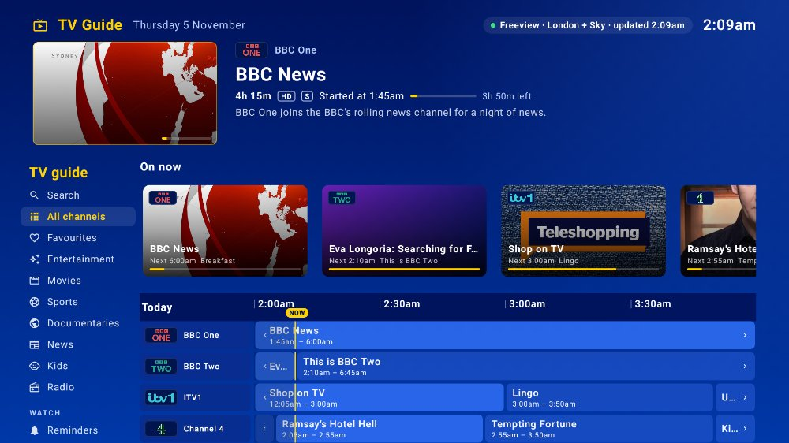
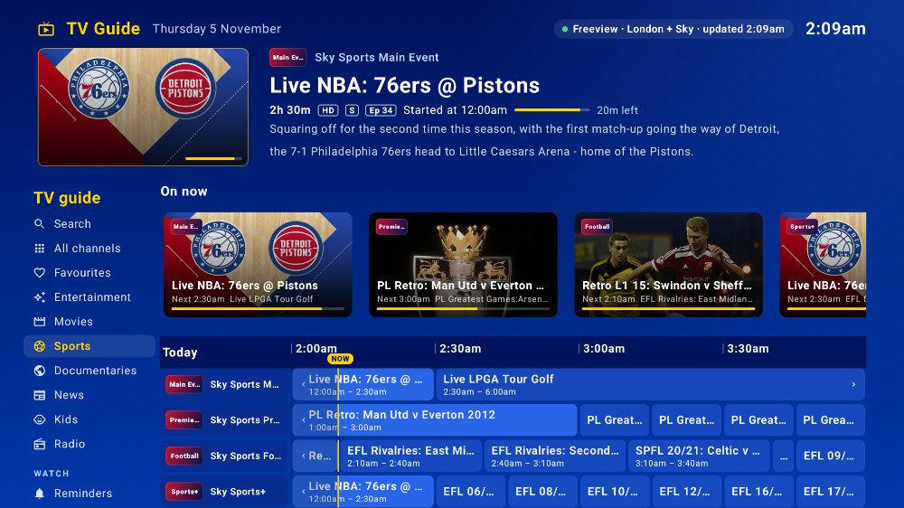
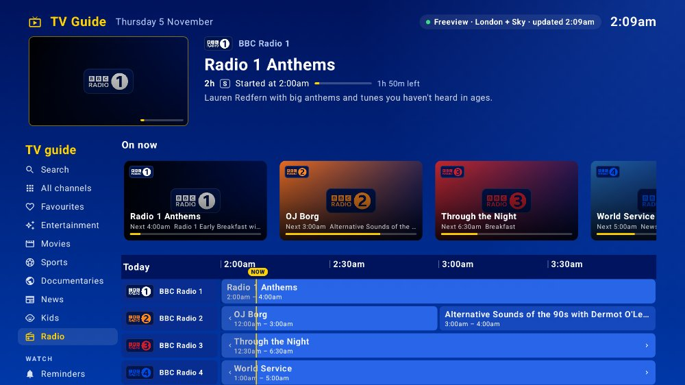
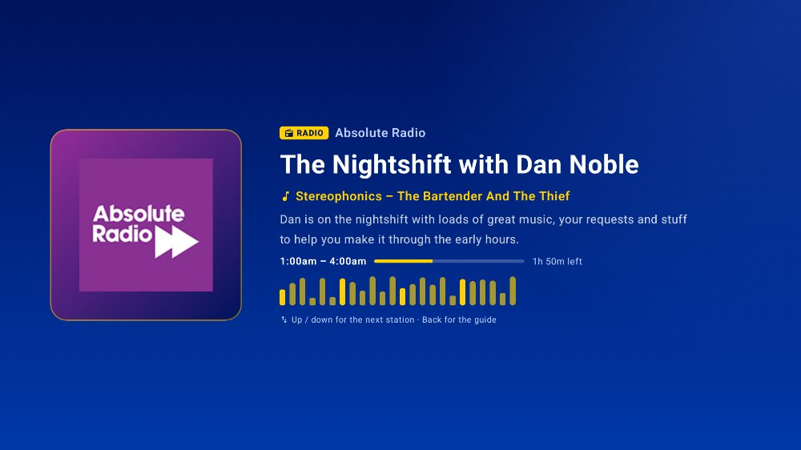
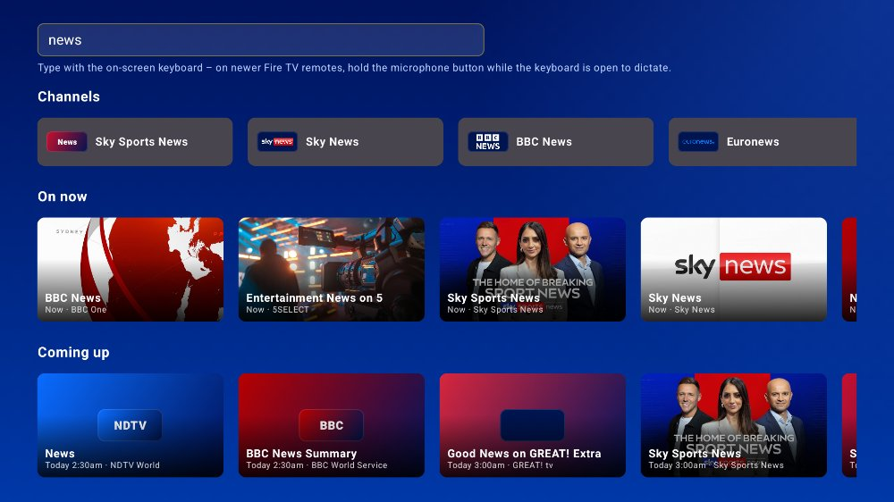
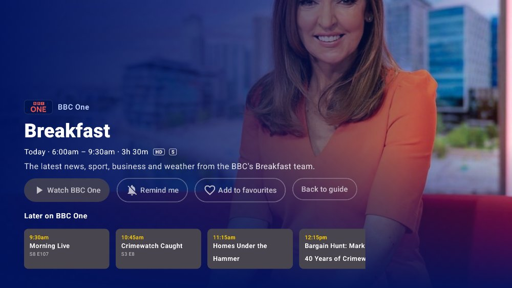
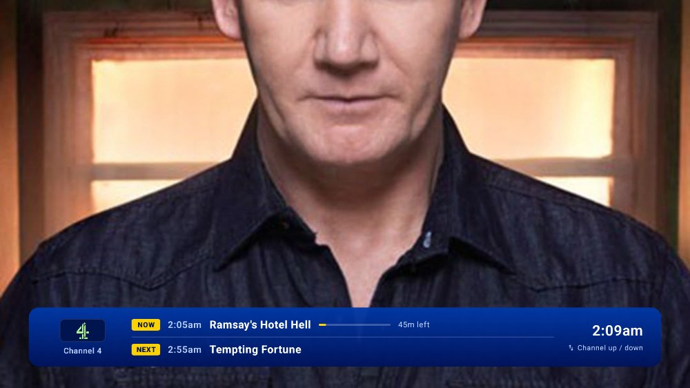
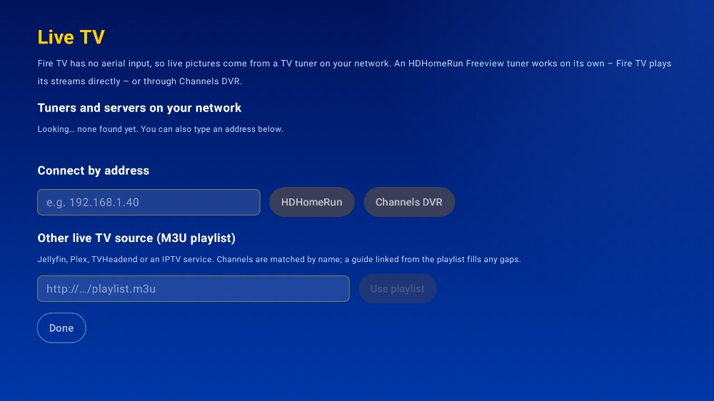

# TV Guide for Amazon Fire TV

The same classic Sky style TV guide as the Apple TV app (`../TVGuide`), built for **Amazon Fire TV** (Fire TV Stick, Stick 4K / 4K Max, Fire TV Cube and Fire TV smart TVs) as a native Android TV app in Kotlin and Jetpack Compose for TV.



| Sky Sports | Radio guide | Radio now playing |
| --- | --- | --- |
|  |  |  |
| **Search** | **Programme info** | **Live TV banner** |
|  |  |  |
| **Live TV setup** | | |
|  | | |

*These are real renders of the app's own screens (Paparazzi, see below) with that night's live Freeview, Sky and Rayo listings – not mock-ups. They show nothing focused, so the yellow selection highlight isn't visible.*

## Same as the Apple TV app

- Classic Sky blue and yellow guide in Sky's channel order (no channel numbers): info panel with a live preview window, **On now** tiles, and a 2 hour timeline that pages by 30 minutes at the edges, with a yellow now line.
- Sidebar: Search, All channels, Favourites, Entertainment, Movies, **Sports**, Documentaries, News, Kids, **Radio**, Reminders, Live TV, Now / Tonight / Tomorrow, region, Sky channels on/off, refresh.
- Listings from the Freeview XMLTV feed, Sky's guide (≈90 Sky channels incl. Sky Cinema and Sky Sports, on by default) and Rayo; 14 Freeview regions.
- **Live TV** in the app with a Sky style now & next banner; up / down (or channel +/-) changes channel; Play/Pause jumps the guide back to now.
- **Radio**: ~156 UK stations (BBC national and local, Global, Rayo – Absolute, KISS, Magic, Cool FM, Downtown, Clyde 1 …) with a now-playing screen showing the show and the song playing; it keeps playing when you press Home.
- **Search** across channels and the week's listings, **reminders**, **favourites**, programme info page, broadcaster-app fallback.

## Fire TV differences

- **HDHomeRun works on its own.** Fire TV's player (ExoPlayer) plays the tuner's MPEG-TS streams directly, so you don't need Channels DVR (Apple TV does). Under **Live TV** the app finds HDHomeRun tuners automatically, or enter the tuner's address; it reads the tuner's channel list and its guide. Channels DVR (found over mDNS) and M3U playlists work too.
- **Voice search:** select the search box and use the Fire TV keyboard (newer remotes let you hold the microphone button to dictate while the keyboard is open). A **Speak** button appears on devices that have a speech recogniser. Alexa's own voice search can't type into third-party apps.
- **Reminders** are stored with **Room** (Android's standard database). Fire TV shows a notification a minute before the start – select it to open the channel – as well as an in-app alert while the guide is open.
- **Broadcaster apps** (BBC iPlayer, ITVX, STV Player, Channel 4, 5, U, NOW) are opened to their home screen; Fire TV apps don't publish deep links to a live channel. Package names are best effort – if one isn't found the app says so.

## Install on a Fire TV

The app isn't in the Amazon Appstore, so install it yourself:

1. On the Fire TV: **Settings → My Fire TV → Developer options** (if it's hidden, open **About** and select the device name 7 times). Turn on **ADB debugging** and **Install unknown apps** (or *Apps from Unknown Sources*).
2. Build the APK (below) or use one built for you: `app/build/outputs/apk/release/app-release.apk`.
3. Either:
   - **adb:** find the Fire TV's IP address under *Settings → My Fire TV → About → Network*, then `adb connect <ip>` and `adb install -r app-release.apk`; or
   - **Downloader app:** put the APK somewhere your Fire TV can reach by URL and open it in Amazon's free *Downloader* app.
4. TV Guide appears under **Your Apps & Channels**.

## Build

Requirements: JDK 17+ and the Android SDK (or Android Studio Ladybug or later).

```sh
cd firetv
./gradlew assembleRelease        # app/build/outputs/apk/release/app-release.apk (signed with the debug key for sideloading)
./gradlew testDebugUnitTest      # unit tests
LIVE_FEEDS=1 ./gradlew testDebugUnitTest --tests '*LiveFeedsTest*'   # also checks the live Freeview, Sky and Rayo feeds
./gradlew recordPaparazziDebug   # re-renders the screenshots with today's listings (app/src/test/snapshots/images)
```

Minimum Fire OS 6 (Android 7.1, API 25), so it runs on Fire TV Stick 2nd generation and newer.

## Project layout

```
app/src/main/java/com/dotnetappdev/tvguide/
  data/Models.kt            Channel, Programme, Region, line-up, radio station types
  data/Catalogues.kt        Regions, line-up, Sky radio and radio catalogue – generated from the Apple TV app's Swift tables
  data/XmltvParser.kt       Streaming XMLTV parser (SAX)
  data/EpgService.kt        Freeview feed download + cache
  data/SkyEpgService.kt     Sky channel line-up and listings
  data/RayoService.kt       Rayo stations: streams, logos, show on air, song
  data/LiveTvSources.kt     HDHomeRun (direct), Channels DVR, M3U playlists
  data/ChannelMatcher.kt    Matches tuner/playlist channel names to the guide
  store/GuideViewModel.kt   State: listings, timeline window, search, tuning, live sources
  reminders/Reminders.kt    Room database, alarms, notifications
  playback/RadioService.kt  Background radio (Media3 session)
  ui/                       Guide, player, radio, detail, search, reminders, Live TV and region screens
```
